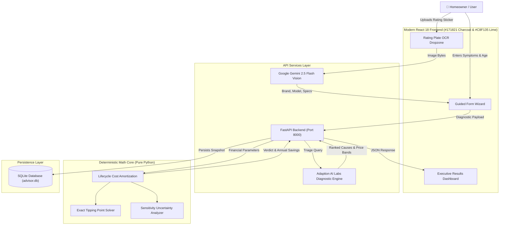

# FixWise — Appliance Repair or Replace Advisor

> **Deterministic Financial Intelligence & AI-Powered Diagnostic Engine for Household Appliances**  
> *Developed for the BharatCode Hackathon*

[](https://fastapi.tiangolo.com)
[](https://reactjs.org/)
[](https://tailwindcss.com/)
[](https://www.python.org/)
[](https://vitejs.dev/)
[](https://deepmind.google/technologies/gemini/)
[](https://adaptionlabs.ai)
[](https://opensource.org/licenses/MIT)

---

## 1. Problem Statement: The Indian Consumer Dilemma

Over **350 million household appliances** power Indian households. When a critical appliance—such as an inverter split AC, front-load washing machine, or double-door refrigerator—breaks down, homeowners face an opaque, high-stakes financial dilemma:

> *"A local technician quoted me ₹4,500 to repair my 5-year-old washing machine. Should I pay the ₹4,500, or is it smarter to replace it with a modern 5-star inverter model for ₹28,000?"*

### Key Consumer Pain Points:
1. **The Sunk-Cost Fallacy & Repeat Failure Trap**: Consumers sink ₹4,000–₹8,000 into dying appliances, only for another component to fail 3 months later. On late-lifecycle units, repeat failure probability ($p$) exceeds 20–30%.
2. **Asymmetric Information & Overcharging**: Without knowledge of OEM part prices, consumers fall prey to inflated technician estimates (e.g., charging ₹4,500 for a ₹750 door latch switch).
3. **The Hidden Electricity Cost**: An aging 8-year-old non-inverter air conditioner consumes ₹8,000–₹12,000 more electricity every year than a modern BEE 5-star inverter unit. Homeowners only see the upfront repair quote and miss the compounding utility penalty.
4. **Mounting Electronic Waste**: Discarding easily repairable appliances after a simple fuse or sensor trip contributes heavily to India's growing e-waste crisis.

**FixWise** provides a mathematically verifiable, transparent answer: an instant AI diagnostic triage, fair OEM part benchmarks, and a **100% deterministic mathematical amortization model** that proves whether repairing or replacing saves more money.

---

## 2. Core Architecture & Innovations



### 1. Zero Math Hallucination (Deterministic Financial Core)
Large Language Models are notoriously prone to arithmetic errors and hallucinated calculations. **FixWise strictly forbids LLMs from performing arithmetic.** 
- AI is restricted to unstructured symptom understanding, OCR vision extraction, and technical triage.
- All amortizations, net present values, sensitivity analysis, and tipping point calculations run deterministically in pure Python (`backend/cost_engine.py`).

### 2. Gemini 2.5 Flash Multimodal Vision OCR
Homeowners frequently struggle to identify their appliance's exact model series, capacity, and electrical specifications.
- Users drop a photo of their appliance model sticker or rating plate.
- **Google Gemini 2.5 Flash Vision** extracts the brand, model number, serial number, voltage, wattage, and error codes in zero-shot JSON format, auto-filling the assessment form.

### 3. Adaption AI Labs Diagnostic Triage
- Built upon fine-tuned diagnostic datasets mapping real-world Indian consumer phrasing (including Hinglish code-switching like *"cooling nahi kar raha"*, *"MCB trip ho rahi hai"*, *"continuous beep alarm"*) to OEM technical failure modes.
- Ranks probable defective components (e.g., door latch switch, drain pump, inverter controller PCB) with DIY feasibility flags and typical labor hours.

### 4. Tipping Point Sensitivity Solver
FixWise doesn't just deliver a static recommendation; it computes the **exact single condition required to flip the outcome**:
> *"To flip the verdict to Replace, the repair quote would need to rise above ₹2,708 (currently ₹2,400), or the repair lifespan would need to drop below 2.8 years (currently 3.0 years)."*

### 5. Executive Dashboard Design System
Inspired by top-tier modern productivity dashboards:
- Deep charcoal navigation bar (`#171821`)
- Electric lime / chartreuse accents (`#C8F135`)
- Clean neutral canvas (`#F5F6F8`)
- Flat white cards with subtle borders (`#E8EAED`)
- **Zero childish emojis** — clean Lucide outline icons throughout.
- Fully responsive across desktop, tablet, and mobile screens.

---

## 3. Mathematical Formulation

All calculations are executed deterministically in [`backend/cost_engine.py`](file:///c:/Users/adity/OneDrive/Desktop/newproject/backend/cost_engine.py).

### A. Total & Annualized Repair Cost
$$\text{Total Repair Outlay } (C_{\text{repair}}) = Q + (t_r \times v) + (p \times Q) + (E_{\text{old}} \times L_r)$$

$$\text{Annualized Repair Cost} = \frac{C_{\text{repair}}}{L_r} = \frac{Q \times (1 + p) + (t_r \times v)}{L_r} + E_{\text{old}}$$

### B. Total & Annualized Replace Cost
$$\text{Total Replace Outlay } (C_{\text{replace}}) = P + D - S + (t_n \times v) + (E_{\text{new}} \times L_n)$$

$$\text{Annualized Replace Cost} = \frac{C_{\text{replace}}}{L_n} = \frac{P + D - S + (t_n \times v)}{L_n} + E_{\text{new}}$$

### Parameter Glossary:
| Symbol | Meaning | Default / Benchmark |
| :--- | :--- | :--- |
| $Q$ | Technician repair quote or OEM replacement component cost | User Input or OEM Part Band |
| $p$ | Probability of repeat breakdown within extended lifespan | 15% (0.15) standard |
| $t_r$ | Owner's time lost dealing with technician & waiting | 4.0 hours |
| $v$ | Monetary value of owner's personal time | ₹350 / hour |
| $E_{\text{old}}$ | Annual electricity running cost of old unit | BEE standard (e.g. ₹3,200/yr for washer) |
| $L_r$ | Expected extended lifespan if repaired | 2.0 to 4.0 years |
| $P$ | Purchase price of brand-new 4/5-star inverter replacement | Retail median (e.g. ₹28,000) |
| $D$ | Delivery, unboxing, and professional installation fee | ₹800 standard |
| $S$ | Salvage, scrap, or old-unit exchange credit | ₹1,500 standard |
| $t_n$ | Owner's time spent researching & receiving new unit | 5.0 hours |
| $E_{\text{new}}$ | Annual electricity running cost of modern 5-star unit | BEE standard (e.g. ₹1,800/yr for washer) |
| $L_n$ | Expected lifespan of brand-new appliance | 8 to 12 years |

### C. Decision & Uncertainty Logic
- **Verdict**:
  - If $\text{Annualized Repair Cost} < \text{Annualized Replace Cost}$ &rarr; **`REPAIR`**
  - If $\text{Annualized Replace Cost} < \text{Annualized Repair Cost}$ &rarr; **`REPLACE`**
- **Sensitivity & Confidence**:
  - Parameters are perturbed by $\pm 20\%$.
  - If the verdict remains identical across all worst-case scenarios &rarr; **`Firm Recommendation`**.
  - If any realistic perturbation flips the verdict &rarr; **`Close Call (Verify Volatile Parameter)`**.

---

## 4. Indian Appliance Benchmark Catalog

Pre-configured with real-world Indian retail and servicing standards:

| Appliance Category | Median New Price ($P$) | Typical Lifespan ($L_n$) | Old Running Cost ($E_{\text{old}}$) | 5-Star Running Cost ($E_{\text{new}}$) | Common Faults |
| :--- | :---: | :---: | :---: | :---: | :--- |
| **Washing Machine** | ₹28,000 | 10 yrs | ₹3,200 / yr | ₹1,800 / yr | Door lock (dE), Drain pump (OE), Inlet valve |
| **Air Conditioner** | ₹42,000 | 8 yrs | ₹11,500 / yr | ₹6,500 / yr | Gas leak (EC), Inverter PCB, Compressor |
| **Refrigerator** | ₹32,000 | 12 yrs | ₹4,800 / yr | ₹2,400 / yr | Defrost bi-metal, Starter relay, Fan motor |
| **Water Purifier (RO)** | ₹16,000 | 6 yrs | ₹1,200 / yr | ₹800 / yr | Sediment/carbon filter, RO membrane, SMPS |
| **Water Heater (Geyser)** | ₹12,000 | 7 yrs | ₹5,500 / yr | ₹3,200 / yr | Shorted heating element, Thermostat |
| **Microwave Oven** | ₹14,000 | 8 yrs | ₹1,800 / yr | ₹1,200 / yr | Magnetron, High voltage diode, Turntable motor |

---

## 5. Project Directory Map

```text
FixWise/
├── backend/
│   ├── main.py                 # FastAPI application, CORS, and routing
│   ├── cost_engine.py          # Deterministic financial amortization engine
│   ├── appliance_inference.py  # Adaption AI Labs & domain diagnosis engine
│   ├── vision_client.py        # Gemini 2.5 Flash multimodal OCR client
│   ├── database.py             # SQLAlchemy database session & SQLite connection
│   ├── models.py               # ORM models: Cases, PartPriceBands, References
│   ├── schemas.py              # Pydantic v2 validation contracts
│   └── adaption_pipeline.py    # Adaption Labs MLOps data pipeline (Forge, Invent)
├── frontend/
│   ├── src/
│   │   ├── components/
│   │   │   ├── StepWizard.jsx          # Guided 3-step assessment form
│   │   │   ├── VerdictCard.jsx         # Header verdict callout with firm badge
│   │   │   ├── FlipBanner.jsx          # Tipping point callout banner
│   │   │   ├── CostComparisonTable.jsx # Side-by-side amortized cost breakdown
│   │   │   ├── RankedCausesList.jsx    # Ranked failure modes & component bands
│   │   │   ├── PhotoDropzone.jsx       # Rating plate OCR photo dropzone
│   │   │   └── LoadingState.jsx        # Step-by-step progress loader
│   │   ├── services/
│   │   │   └── api.js                  # Resilient API client with cloud fallbacks
│   │   ├── App.jsx                     # Dashboard shell with charcoal sidebar
│   │   └── index.css                   # Tailwind styling & JetBrains Mono font
│   ├── tailwind.config.js              # Custom theme (brand-dark, brand-lime)
│   ├── vite.config.js                  # Vite server & proxy error interceptor
│   └── package.json                    # Frontend dependencies
├── data/
│   └── sample_appliance_manuals.json   # Reference repair bulletins & fault codes
├── tests/
│   └── test_cost_engine.py             # 17 comprehensive pytest unit tests
├── .env.example                        # Sanitized environment configuration
├── .gitignore                          # Excludes secrets, databases, and node_modules
├── BharaCode.txt                       # BharatCode Hackathon comprehensive overview
├── docker-compose.yml                  # One-click containerized deployment
├── Dockerfile                          # Multi-stage production container
├── requirements.txt                    # Python dependencies
├── run.bat                             # Windows 1-Click Interactive Launcher
└── run.ps1                             # PowerShell 1-Click Interactive Launcher
```

---

## 6. Setup & Local Development

### Prerequisites
- **Python 3.10+**
- **Node.js 18+**
- *(Optional)* **Docker Desktop**

### Step 1: Clone & Configure Secrets
```bash
git clone https://github.com/adityaaa89/FixWise.git
cd FixWise
cp .env.example .env
```
Edit `.env` with your API keys:
```env
# Adaption AI Labs Credentials
ADAPTION_API_KEY=pt_live_your_key_here
ADAPTION_API_BASE_URL=https://api.prod.adaptionlabs.ai/api/v1

# Google Gemini API Key (Multimodal Vision OCR)
GEMINI_API_KEY=your_gemini_key_here
```

---

### Step 2: Launch Application

#### Method A: 1-Click Windows Launcher (Recommended)
Double-click [`run.bat`](file:///c:/Users/adity/OneDrive/Desktop/newproject/run.bat) or [`run.ps1`](file:///c:/Users/adity/OneDrive/Desktop/newproject/run.ps1):
```text
============================================================
     Repair or Replace Advisor - Local Development
============================================================

 [1] Start Full Stack via Docker Compose (Recommended)
 [2] Start React Frontend Dev Server (http://localhost:3000)
 [3] Start FastAPI Backend Server (http://localhost:8000)
 [4] Build Production Frontend Bundle (Vite)
 [5] Exit
```

#### Method B: Manual Startup

**Terminal 1 — Backend**:
```bash
pip install -r requirements.txt
uvicorn backend.main:app --host 0.0.0.0 --port 8000 --reload
```

**Terminal 2 — Frontend**:
```bash
cd frontend
npm install
npm run dev
```
Open **`http://localhost:3000`** in your browser.

#### Method C: Docker Compose
```bash
docker-compose up --build
```

---

## 7. REST API Documentation

### 1. Diagnostic Triage
```http
POST /api/diagnose
Content-Type: application/json

{
  "appliance_type": "Washing Machine",
  "brand": "IFB",
  "age": 4.0,
  "symptom_text": "Machine starts wash cycle, beeps continuously and stops with dE error code."
}
```
**Response (200 OK)**:
```json
{
  "case_id": "case_246b64a834ce",
  "appliance_type": "Washing Machine",
  "brand": "IFB",
  "age_assessment": "Mid Lifecycle: At 4.0 years, appliance has used 40% of its expected 10 yr lifespan.",
  "triage_level": "EMERGENCY",
  "ranked_causes": [
    {
      "rank": 1,
      "cause": "Door lock thermal interlock switch microswitch stuck or coil open",
      "diy_difficulty": "Moderate DIY",
      "cost_band": { "low": 650.0, "high": 1500.0 },
      "estimated_labor_hours": 0.8
    }
  ]
}
```

---

### 2. Deterministic Financial Verdict
```http
POST /api/verdict
Content-Type: application/json

{
  "Q": 2400.0,
  "P": 28000.0,
  "L_r": 3.0,
  "L_n": 10.0,
  "E_old": 3200.0,
  "E_new": 1800.0,
  "p": 0.15,
  "v": 350.0,
  "D": 800.0,
  "S": 1500.0,
  "tr": 4.0,
  "tn": 5.0,
  "case_id": "case_246b64a834ce"
}
```
**Response (200 OK)**:
```json
{
  "verdict": "Repair",
  "confidence": "close",
  "annual_repair_cost": 4586.67,
  "annual_replace_cost": 4705.00,
  "annual_savings": 118.33,
  "flip_assumption": "To flip the verdict to Replace, the repair lifespan would need to drop below 2.8 years (currently 3.0 years), or the repair quote would need to rise above ₹2,708.70 (currently ₹2,400.00).",
  "tipping_points": {
    "L_r": 2.76,
    "Q": 2708.70,
    "P": 26816.67
  }
}
```

---

### 3. Model Sticker Vision OCR
```http
POST /api/photo
Content-Type: multipart/form-data

file: [binary image data]
hint_brand: "IFB"
hint_type: "Washing Machine"
```
**Response (200 OK)**:
```json
{
  "brand": "IFB",
  "model_number": "SENATOR SMART TOUCH 8.5KG",
  "serial_number": "IFB-2024-884920",
  "appliance_type": "Washing Machine",
  "electrical_specs": {
    "voltage": "230V AC",
    "frequency": "50 Hz",
    "wattage": "2100W"
  },
  "confidence_score": 0.95,
  "advisory_tip": "Verified via Gemini Vision Model (gemini-2.5-flash)."
}
```

---

## 8. Verification & Test Suite

The deterministic financial engine includes a complete pytest unit test suite covering:
- Standard cost amortization calculations
- Exact mathematical tipping point solver verification
- Edge cases: $Q=0$ (free warranty repair), $L_r \to 0$, $p \to 1.0$ (guaranteed repeat failure)
- Exact financial tie conditions
- Sensitivity analysis across parameter perturbations

Run the tests:
```bash
pytest tests/
```

---

## 9. Hackathon Impact: Aligned with National Priorities

1. **Consumer Financial Literacy**: Empowers middle-class families to make informed, data-driven decisions rather than succumbing to high-pressure technician sales pitches.
2. **National Energy Efficiency**: By incorporating BEE star energy consumption tariffs (₹8.50/kWh median), FixWise quantifies the real-world utility cost of running obsolete appliances.
3. **E-Waste Mitigation**: Prevents premature disposal of repairable appliances, keeping functional hardware out of Indian landfills.

---

## 10. License

Released under the **MIT License**. Free for academic, personal, and commercial development.
